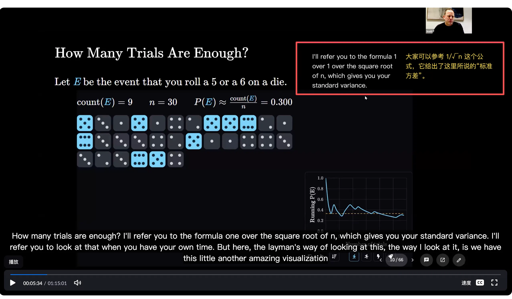
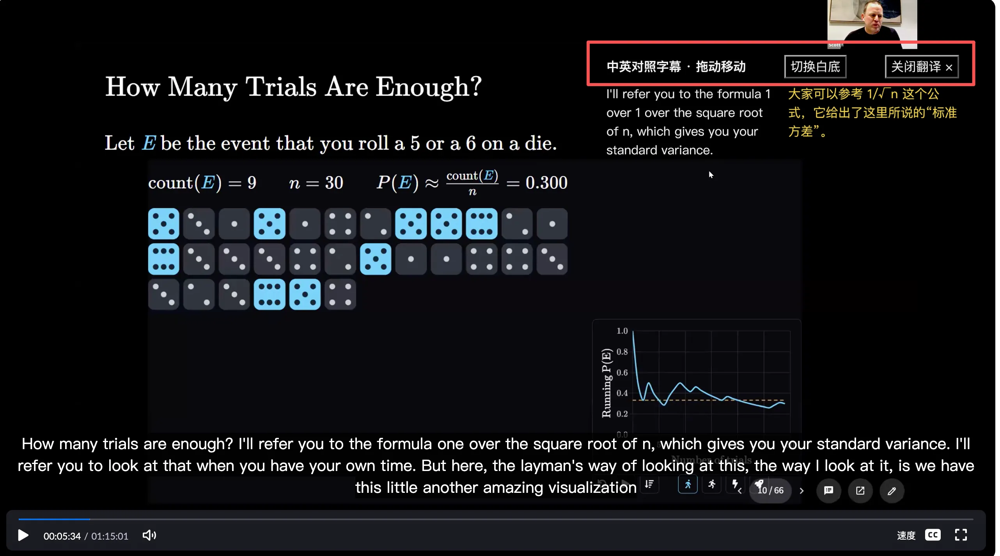
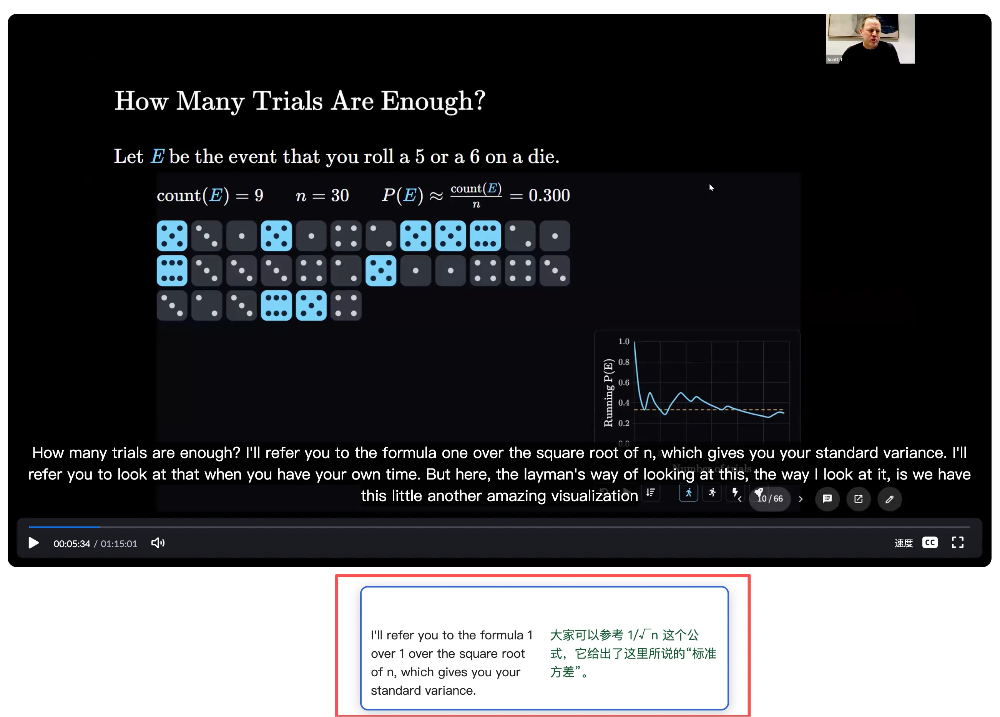
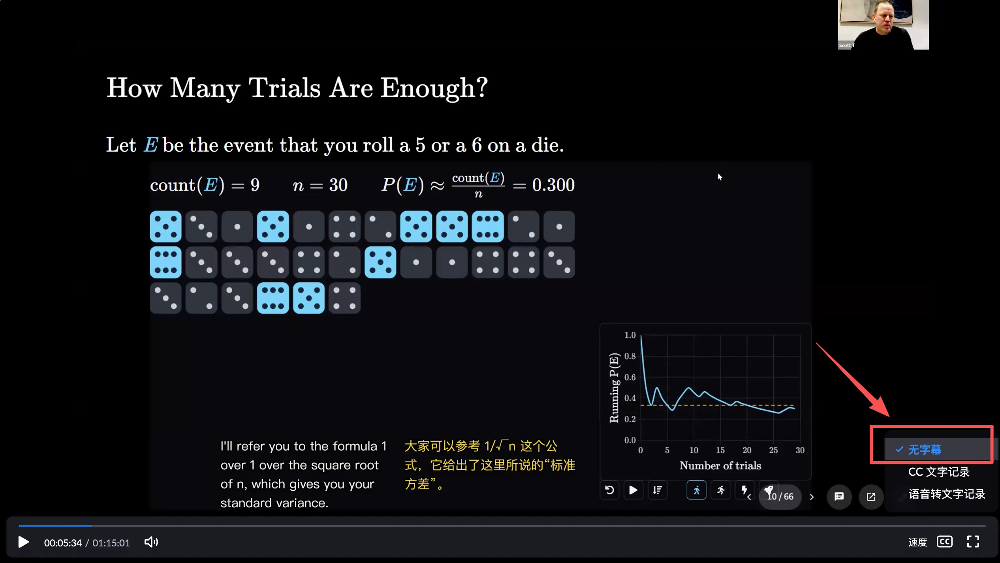

# Video Bilingual Captions

一个用于 AI 编程助手的网页视频双语字幕技能。包含专属用户脚本生成器和可选本机翻译接口；不包含课程字幕、音频、账号数据或内置翻译模型。

## 安装技能

将此目录复制到 `~/.codex/skills/video-bilingual-captions`，重新打开会话以便技能被发现。直接说“开双语字幕”，或明确调用 `$video-bilingual-captions` 并附上视频链接。

## 支持范围

录播支持两种可切换模式：**1. 全部翻译完，但起步慢**；**2. 同步翻译，能接受略微延迟**。已有完整英中字幕可直接使用；同步模式先显示原文，提前翻译后续片段，译文就绪后补上。

直播支持读取平台实时英文字幕（HTML5 TextTrack 或适配的字幕 DOM），采用同步模式。无字幕直播暂不内置采音和实时语音识别，需要另接转写源。iframe、桌面客户端和受限制播放器需要另行适配。实际延迟取决于字幕源与翻译服务，不能保证任意视频都秒开或无感延迟。

**中文语音同传（可选）**：已有完整中文译文的录播可加 `--speech`，按视频时间播报中文，带独立开关、声音选择及可选原声降低；语音默认关闭。与字幕共用数据，关闭字幕仍可听中文。当前不支持直播或边翻译边播报，详见 [语音同传说明](references/speech.md)。

运行方式和输入格式见 [SKILL.md](SKILL.md)。浏览器需要用户脚本管理器。生成器和可选服务仅使用 Python 标准库。已有完整译文的脚本保持离线；同步翻译需要配置接口，字幕将发送到所选服务。配置、直播命令和延迟说明见 [翻译接入说明](references/translation.md)。

回归验证：`python3 -m unittest discover -s tests -v`、`node --test tests/translation-runtime.test.js tests/chinese-interpretation.test.cjs`；macOS 安装 Chrome 后可运行 `python3 tests/browser_checks.py`，在隔离配置中使用模拟译文与语音验证，真实出声需另行试听。

## 开源范围

本目录代码采用 MIT 许可。视频及字幕内容不随仓库发布，其版权和使用许可由来源决定。发布新例子时使用自行创作的短文本。

## 效果示例

#### 透明浮窗

#### 鼠标放上去会显示相关设置栏

#### 移动窗口 + 不透明浮窗

#### 关闭软件自带的字幕

